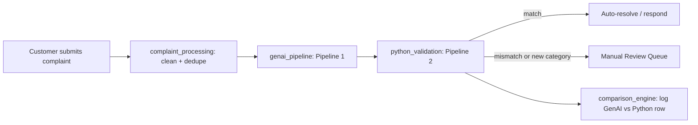

# Architecture Notes (working doc — expand into the Project Report's §3)

- Two pipelines never share a verdict path: Pipeline 1 proposes, Pipeline 2 disposes.
- `knowledge_base/` and `complaint_rules/rule_matrix.csv` are the only sources
  of truth Pipeline 2 is allowed to check against — never Pipeline 1's own output.
