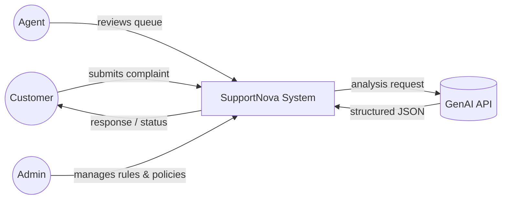
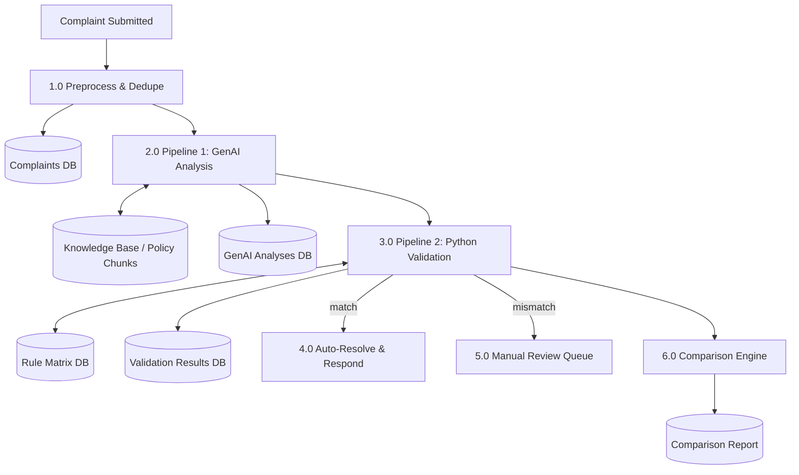
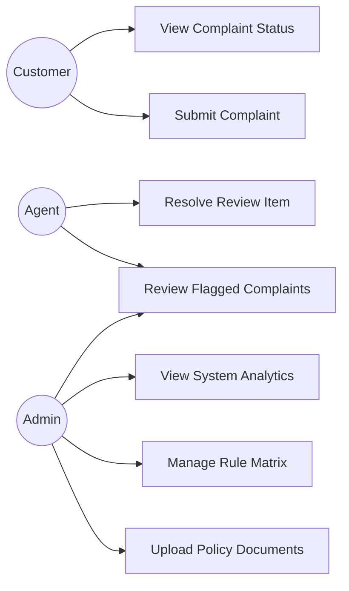
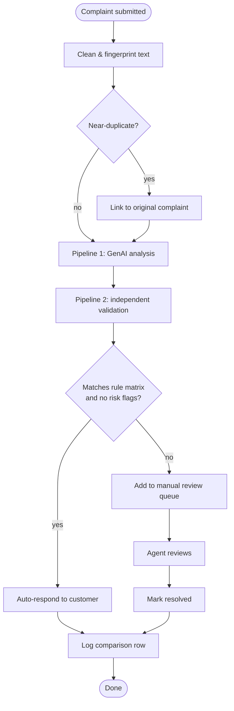
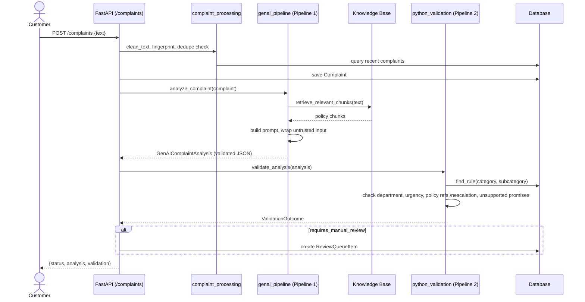

# Diagrams

Source of truth for the Project Report's §3.4–3.7. Mermaid renders natively
on GitHub — copy these blocks straight into the report.

## 3.4 Data Flow Diagram (Level 0 — Context)

## 3.4 Data Flow Diagram (Level 1)

## 3.5 Use Case Diagram

## 3.6 Activity Diagram — Complaint Lifecycle

## 3.7 Sequence Diagram — Complaint Submission

